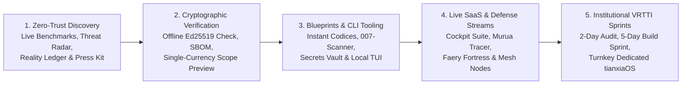

# Customer Journey, Buyer Personas & Trust Architecture

> **Governance Alignment:** Designed in strict compliance with the **RASA-X-MACHINA** Single-Currency Consistency Mandate (42 markets · 25 languages · 29 currencies) and Client-Facing Confidentiality Standard. Every stage of the client experience is anchored in **verifiable cryptographic proof before commitment**.

---

## 1. Core Audience & Buyer Personas

| Persona | Primary Role & Context | Core Operational Pain | Primary Entry Surface | Flagship Adoption Outcome |
| :--- | :--- | :--- | :--- | :--- |
| **1. Sovereign Systems Builder** | Staff/Principal Engineer, Rust/Nix Architect, AI Infrastructure Lead | Runaway frontier LLM API bills, HTTP 429 burst failures, brittle Python/Docker agent sprawl | `github.com/Tianxia-Core/tianxiaos-releases` · `tianxia.rasaxmachina.com` | Installs Ed25519-signed `tianxiaOS` CLI/TUI, adopts Operator's Manual & KAI³ blueprints, scales to Pro 5-Node Mesh |
| **2. Enterprise CISO & Security Lead** | Head of InfoSec, FinTech/DeFi Security Architect, DPO | Shared-kernel sandbox escapes, clipboard/secret leakage, slow GDPR erasure, reconnaissance bots | `radar.rasaxmachina.com` · `fortress.rasaxmachina.com` · `trust.rasaxmachina.com` | Deploys 007-Scanner & Aethervault (`<50ms` PQ cryptoshred), subscribes to Faery Fortress, books Zero-Trust Audit Sprint |
| **3. Cross-Border Merchant & Quant Operator** | E-commerce Operations Director, Treasury/Desk Lead | False "Item Not Received" (INR) chargebacks, cross-border parcel black holes, unverified signal feeds | `tracer.rasaxmachina.com` · `alpha.rasaxmachina.com` · `ledger.rasaxmachina.com` | Integrates Murua Universal Tracer (`62.4%` INR dispute reduction) & Veritas Solvency API |
| **4. Institutional Partner, Investor & Media** | Startup Committee Reviewer, Deep-Tech VC, Technology Journalist | Distinguishing real bare-metal engineering from wrapper vaporware; verifying cap-table & IP readiness | `estonia.rasaxmachina.com` · `press.rasaxmachina.com` · `collins.rasaxmachina.com` | Verifies live telemetry, CycloneDX SBOM, signed binaries, broadcast pitch videos, and books 4h-SLA executive briefing |

---

## 2. The 5-Stage Sovereign Customer Journey

### Stage 1 — Zero-Trust Discovery & Immediate Utility
- Visitors arrive on `rasaxmachina.com` or specialized portals (`tianxia`, `radar`, `tracer`, `ledger`, `estonia`, `press`).
- Within 2 seconds, the interface detects market/locale (42 markets, 25 languages including RTL `ar`/`ur`, 29 currencies) and locks **100% of prices, interactive scope calculators, and payment descriptors (`RASAXMACHINA * [SKU]`) into a single consistent currency**.
- Rather than gated whitepapers or pop-ups, visitors inspect live cluster telemetry (`4/5` active Tailscale + Rosenpass PQ mesh nodes), real CISA KEV threat feeds, and Merkle-attested ledger hashes immediately.

### Stage 2 — Offline Cryptographic Verification (Zero-Risk Proof)
- Technical buyers verify claims before spending a cent: downloading `v8.7.0` binaries (`.deb`, `.rpm`, `.AppImage`, `flake.nix`, `.tar.gz`, `.exe`, `.apk`) and validating `SHA256SUMS.sig` offline against our public Ed25519 key (`RELEASE_SIGNING_KEY.pub.pem`) plus CycloneDX 1.5 `SBOM.cdx.json`.

### Stage 3 — Accessible Entry Blueprints & Standalone Engineering Tools
- Builders start with self-contained, instant-delivery blueprints and standalone tools (5K Autonomous Blueprint, KAI³ Architecture Codex, Operator's Manual, JobMatch Honest CV Firewall) delivered immediately via Stripe multi-currency checkout or x402 machine-to-machine settlement.

### Stage 4 — Recurring Operational Telemetry, Cyber-Defense & Asset Escrow
- Growing teams activate continuous SaaS and cyber-defense capabilities: Sovereign Cockpit Suite, Alpha Arbitrage Signals, Veritas Solvency API, Murua Consignment Tracer API, Faery Fortress & Secret Vault Suite, and NomenAgora Digital Namespace Escrow.

### Stage 5 — Executive VRTTI Engineering Sprints & Turnkey Sovereign Clusters
- Institutional clients scope bespoke architecture engagements transparently using the interactive Scope Calculator (`2-Day Architecture Audit`, `Zero-Trust Security Assessment`, `5-Day VRTTI Production Sprint`, `Fractional Principal Architect`, or `Turnkey 10K Dedicated tianxiaOS Substrate`) and connect via our bot-shielded 4-hour SLA executive channels (`/collins`, `/whatsapp`, Merkle Brief dispatch).

---

## 3. Privacy-First Post-Onboarding Experience (`GDPR++` v2030.4)
- **Zero Third-Party Tracking Pixels:** No invasive ad-tech trackers, session-replay spyware, or cross-site behavioral fingerprinting.
- **Anti-Scraper Contact Shield:** Executive channels protect both client and founder communications behind human-verified session gates (`/whatsapp` and `TX_CONTACT_SHIELD`).
- **`< 50ms` Cryptoshredding Guarantee:** Any client workspace or ephemeral enclave can execute cryptographic key destruction (`XChaCha20-Poly1305 + ML-KEM-1024`) in under 50 milliseconds with a signed Merkle erasure receipt.
